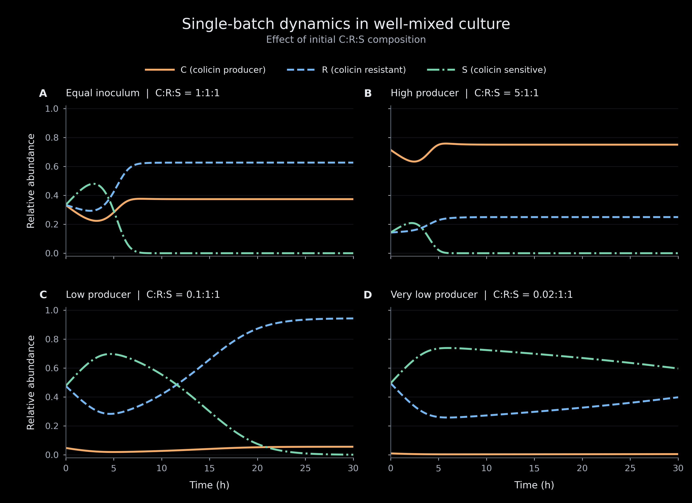
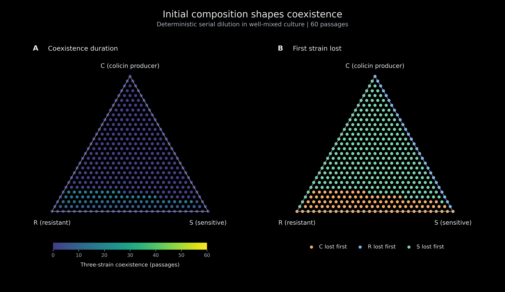
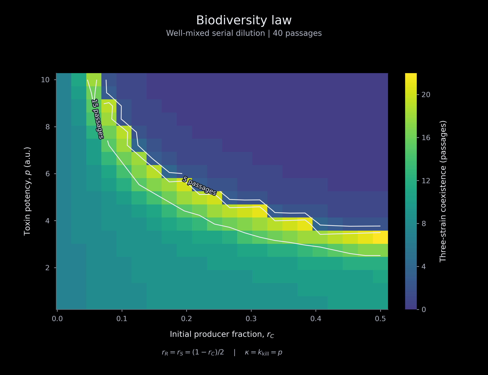

# C:R:S 应用模型

## 建模目标

应用模型研究在均匀培养条件下，Colicin 产生菌（C）、抗性菌（R）和敏感菌（S）的
初始比例如何影响菌株竞争与短暂共存。该模型为比例库提供生物学解释：将设计或测得的
组成映射到预期菌株轨迹、共存时长与值得采样的区域。

模型假设培养体系充分混合，菌株共享资源，并由作用于整个培养体系的毒素浓度 T
表示毒素暴露。模型不表示空间邻域，也不包含 R 菌对附近 S 菌的局部保护。因此，
共存以有限观测时间或连续传代中的持续时间来衡量，而非假定为永久稳定状态。

## 结果

### 竞争关系与毒素动力学

在本应用模型中，毒素的产生、降解及其对敏感菌的杀伤被显式纳入平均场方程：

$$
\begin{aligned}
\frac{dC}{dt} &= \mu_C C\left(1-\frac{N}{K}\right),\\
\frac{dS}{dt} &= \mu_S S\left(1-\frac{N}{K}\right)-k_{\mathrm{kill}}TS,\\
\frac{dR}{dt} &= \mu_R R\left(1-\frac{N}{K}\right),\\
\frac{dT}{dt} &= \kappa C-\delta T,\qquad N=C+R+S.
\end{aligned}
$$

其中，C 为产毒菌株，R 为抗性菌株，S 为敏感菌株，T 为毒素浓度，N 为总菌量，
K 为承载量。毒素由 C 产生并逐渐降解，同时杀伤 S。模拟生长速率为
$\mu_S\approx1.29$、$\mu_R=1.00$、$\mu_C\approx0.90$，以 $\mu_R$ 归一化。
代码将资源限制项截断为 $\max(0,1-N/K)$；在 $N\leq K$ 时与上述形式一致。

这里的时间为归一化模型时间；图中小时标注采用示例参考生长速率
$\mu_R=1\,\mathrm{h}^{-1}$ 的解释。用于实验时间安排前，应根据菌株实测生长速率标定。

### 单批次培养：初始比例影响短期轨迹

我们模拟四组初始 C:R:S 比例：1:1:1、5:1:1、0.1:1:1 和 0.02:1:1，观察
30 个模型时间单位内的变化。即使生长与毒素参数相同，不同初始组成也会产生不同
群体轨迹：初始 C 较高时，毒素更快积累，S 受到更强抑制；初始 C 较低时，S
能维持更长时间。

*图 3-1｜不同初始比例下 C、R、S 在单批次培养中的相对丰度变化。*

### 连续传代：筛选共存比例区域

我们模拟 **435 个初始 C:R:S 组成**，连续传代 60 轮。每轮培养 12 个模型时间单位
后，按 1:100 稀释到新鲜培养基，并将毒素浓度重置为零。每轮结束时，某菌株相对
丰度低于 $10^{-6}$ 即记录为阈值下的丢失；三菌共存时长为首个阈值跨越前完成的传代数。

435 个组成中，276 个组成的三菌共存指标为零；其中也包含初始即缺失某菌株的边界
组成。较高初始 C 下，S 往往首先降至阈值以下。较长的三菌共存主要出现在 C 较低的
区域，本次扫描最长维持 **20 轮**。在部分低 C 区域，C 首先降至阈值以下。
该图不单独测量 C 减少后 R、S 的双菌共存时长。

*图 3-2｜初始组成对三菌共存传代数和首个降至阈值以下的菌株的影响。*

### 毒素效力：调整候选初始比例

我们建立 22 × 18 的参数网格，扫描初始 C 比例和毒素效力，共 396 组条件。每个
条件下，R 与 S 平分剩余比例；共同扫描参数 p 设置为 $\kappa=k_{\mathrm{kill}}=p$，
并连续传代 40 轮。p 是共同参数的示例扫描坐标，并非二者乘积。

扫描中的共存区域随毒素效力变化：在共存区域的高 C 边界附近，毒素效力增加时，
达到相同共存时长所允许的初始 C 比例降低。C 的比例需要与毒素动力学相匹配，
过高的初始 C 可能过快抑制 S；该关系不能理解为任意条件下 C 越少越好。

*图 3-3｜初始 C 比例与毒素效力共同影响模型预测的共存时长；等高线标示 5 和 15 轮。*

## 对实验设计的启示

模型提示可优先考察 C 占比较低的区域，并以 R、S 比例接近的组成作为探索起点。
约 5–20% 的 C 可作为待测试的候选范围，具体选择随毒素效力和生长速率改变，
不能作为已实验验证的最优区间。

比较不同配比时，应记录并统一接种后的观测时间，结合实测生长速率标定模型时间。
当某菌株的初始绝对数量较低时，应设置生物学重复，以评估随机波动的影响；本模块
采用确定性模型，不对随机丢失概率作定量预测。

这些结果用于缩小待测比例范围、辅助安排采样时间。实际选择仍需结合应用目标、
毒素效力、生长条件和测量时间判断，并用实验数据验证。

---

发布说明：本文件中的相对图片路径只用于本地预览，线上请替换为 iGEM Uploads
返回的图片 URL，并添加实际软件仓库源码链接、文献与作者署名。原正文中关于
拓扑模型持续振荡的结果未在此包提供复现源码，补齐对应证据后可另加段落。
